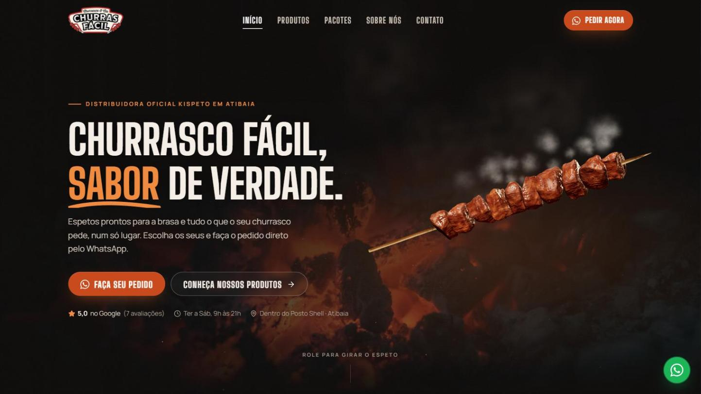

# Churras Fácil




> Landing page for **Churras Fácil — Churrasco & Cia**, an official Kispeto distributor in Atibaia (São Paulo, Brazil). It features a 3D skewer that turns as you scroll, the full menu and barbecue packages, with every order sent through WhatsApp.

🔗 **Live demo:** [churras-facil.vercel.app](https://churras-facil.vercel.app)

## ✅ Features

- [x] 3D skewer built with Three.js that rotates in sync with page scroll (GSAP ScrollTrigger + Lenis smooth scrolling)
- [x] Menu with 28 products and prices taken from the store's WhatsApp catalog
- [x] 1 kg and 2 kg packages section, filled automatically from the menu
- [x] "Order on WhatsApp" buttons with pre-filled messages for each product
- [x] Opening hours, location and Google rating shown in the hero
- [x] Pre-rendered HTML (SSR at build time) for SEO and fast first load
- [x] Optimized images in AVIF and WebP, generated by scripts with sharp
- [x] Accessibility: button to pause animations (WCAG 2.2.2)
- [x] Privacy and credits pages
- [x] Responsive layout with floating WhatsApp button

## 🛠 Technologies

      

Also: Lucide icons, Lenis smooth scroll, Fontsource fonts and sharp for image processing.

## 💻 Prerequisites

Before you begin, make sure you have:

- [Node.js](https://nodejs.org/) 20.19 or newer
- [Git](https://git-scm.com/) installed

## 🚀 Installing Churras Fácil

To install Churras Fácil, follow these steps:

Linux and macOS:

```bash
git clone https://github.com/NathanCarvalhodaCunha/churras-facil-site.git
cd churras-facil-site
npm install
```

Windows:

```powershell
git clone https://github.com/NathanCarvalhodaCunha/churras-facil-site.git
cd churras-facil-site
npm install
```

## ☕ Using Churras Fácil

Start the development server and open http://localhost:5173:

```bash
npm run dev
```

| Command | What it does |
|---|---|
| `npm run dev` | development server with hot reload |
| `npm run build` | type-checks, builds the site to `dist/` and pre-renders the HTML |
| `npm run preview` | serves the production build at http://localhost:4173 |
| `npm run images` | generates optimized AVIF and WebP images from the `photos/` folder |
| `npm run brand` | generates the favicon, app icons and link preview image from the logo |

All store information (WhatsApp number, products, prices, opening hours and texts) lives in `src/config/`. The full editing and publishing guide, in Portuguese, is in [`docs/GUIA.md`](docs/GUIA.md).

## 📁 Project structure

```
├── src/
│   ├── components/   # layout, page sections and UI components
│   ├── config/       # store info, products, packages, texts and SEO
│   ├── three/        # 3D skewer scene (geometry, materials, particles)
│   └── lib/          # GSAP setup, smooth scroll, WhatsApp links, opening hours
├── public/           # images, icons, privacy and credits pages
├── scripts/          # image optimization, brand assets and pre-rendering
└── docs/GUIA.md      # editing and publishing guide (Portuguese)
```

## 📫 Contributing to Churras Fácil

To contribute to Churras Fácil, follow these steps:

1. Fork this repository.
2. Create a branch: `git checkout -b <branch_name>`.
3. Make your changes and commit them: `git commit -m '<commit_message>'`
4. Push to the original branch: `git push origin <branch_name>`
5. Create the pull request.

Alternatively, see the GitHub documentation on [creating a pull request](https://docs.github.com/en/pull-requests/collaborating-with-pull-requests/proposing-changes-to-your-work-with-pull-requests/creating-a-pull-request).

## 🤝 Contributors

<table>
  <tr>
    <td align="center">
      <a href="https://github.com/NathanCarvalhodaCunha" title="Nathan Carvalho da Cunha on GitHub">
        <br>
        <sub>
          <b>Nathan Carvalho da Cunha</b>
        </sub>
      </a>
    </td>
  </tr>
</table>
